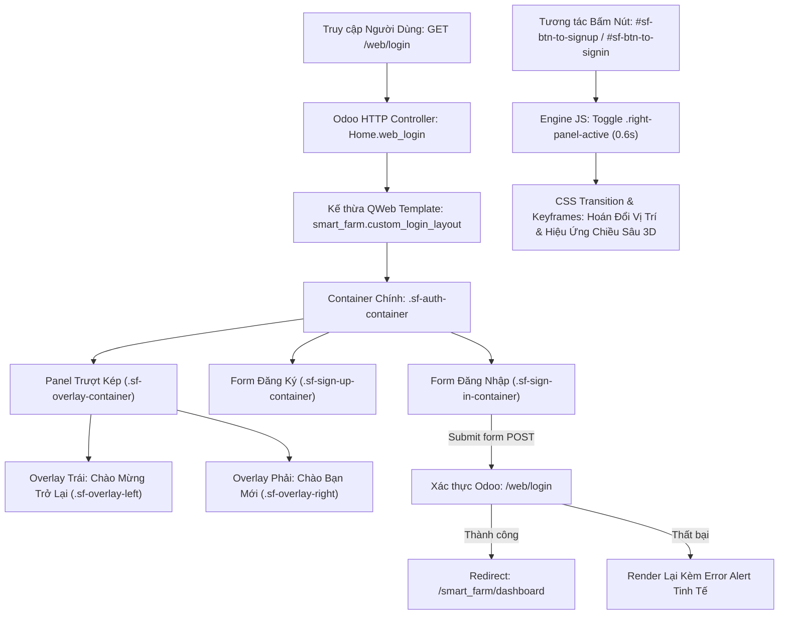

# Implementation Plan: Giao Diện Đăng Nhập & Đăng Ký Trượt Kép Hiện Đại (Modern Animated Sliding Auth Screen)

**Feature**: `009-animated-sliding-login` | **Spec**: [`spec.md`](./spec.md)  
**Status**: Lập Kế Hoạch Kỹ Thuật (Bước 2 của Lifecycle Policy)  

---

## 1. Kiến Trúc Kỹ Thuật (Technical Architecture)

---

## 2. Chi Tiết Thành Phần Kỹ Thuật & Tệp Triển Khai

### 2.1 QWeb Templates (`smart_farm/views/login_templates.xml`)
- Kế thừa `web.login_layout` hoặc `web.login`:
  - Thay thế wrapper mặc định bằng khung nền trang nhã toàn màn hình (`sf-auth-page-wrapper`), hoa văn mờ sinh thái nông nghiệp (`#f0fdf4` / `#f8fafc`).
  - Định nghĩa cấu trúc 3 phần tử cốt lõi:
    1. `.sf-sign-in-container`: Chứa form đăng nhập thực tế của Odoo (`action="/web/login"`, `method="post"`, `csrf_token()`, trường `login`, `password`, `redirect`, xử lý `error` và `message`).
    2. `.sf-sign-up-container`: Chứa form đăng ký tài khoản mới theo đúng thiết kế Ảnh 1.
    3. `.sf-overlay-container`: Chứa panel gradient xanh ngọc với các nút chuyển đổi (`#sf-btn-to-signup` và `#sf-btn-to-signin`).
- Khai báo file template trong `__manifest__.py` phần `'data'`.

### 2.2 Định Kiểu CSS & Hiệu Ứng Chuyển Động (`smart_farm/static/src/css/login.css` hoặc tích hợp vào bundle web)
- Đăng ký asset vào bundle `web.assets_frontend` để tự động tải tại trang `/web/login`.
- **Hệ thống Design Tokens**:
  - Primary Gradient: `linear-gradient(135deg, #10b981 0%, #059669 50%, #0d9488 100%)` (Tone xanh ngọc tươi sáng đặc trưng cho Smart Farm).
  - Background Accent: Các họa tiết hình học bán nguyệt, khối lập phương mờ (geometric shapes) chuẩn theo ảnh mẫu.
  - Border Radius: Container `20px`, Inputs & Buttons `25px - 9999px` (dạng viên thuốc pill-shaped).
  - Box Shadows: Đổ bóng mờ nhiều tầng `0 14px 28px rgba(0,0,0,0.08), 0 10px 10px rgba(0,0,0,0.06)`.
- **Logic Animation CSS**:
  - Trạng thái mặc định: `.sf-sign-in-container` hiển thị bên trái (z-index 2), `.sf-overlay-container` nằm bên phải (50%).
  - Trạng thái kích hoạt `.right-panel-active`:
    - `.sf-overlay-container` dịch chuyển `translateX(-100%)`.
    - `.sf-overlay` dịch chuyển `translateX(50%)`.
    - `.sf-sign-in-container` dịch chuyển `translateX(100%)` và ẩn z-index.
    - `.sf-sign-up-container` dịch chuyển `translateX(100%)`, chuyển `opacity: 1` và z-index 5 qua keyframe `@keyframes sfShow`.

### 2.3 JavaScript Điều Khiển (`smart_farm/static/src/js/login.js`)
- Lắng nghe sự kiện click:
  - Khi click `#sf-btn-to-signup`: Thêm class `.right-panel-active` vào container.
  - Khi click `#sf-btn-to-signin`: Gỡ bỏ class `.right-panel-active` khỏi container.
- Tự động kiểm tra trạng thái URL (nếu có tham số `mode=signup`, tự động bật trạng thái Đăng ký khi tải trang).
- Hỗ trợ phím tắt và xử lý form validation mượt mà (ngăn ngừa submit khi để trống).

---

## 3. Kế Hoạch Bóc Tách Subtasks (4 Subtasks)

1. **Subtask 1**: Xây dựng cấu trúc QWeb Template (`smart_farm/views/login_templates.xml`) kế thừa trang đăng nhập Odoo và đăng ký trong `__manifest__.py`.
2. **Subtask 2**: Xây dựng toàn bộ hệ thống CSS & Animation chuyển động trượt kép (`smart_farm/static/src/css/login.css`) chuẩn xác theo 2 ảnh mẫu.
3. **Subtask 3**: Xây dựng mã Javascript tương tác trượt (`smart_farm/static/src/js/login.js`) và đăng ký asset vào bundle `web.assets_frontend`.
4. **Subtask 4**: Tích hợp luồng xác thực Odoo (CSRF, Submit POST, Redirect vào Dashboard, Xử lý Error Alert, Responsive Mobile) và Kiểm thử toàn diện.

---

## 4. Kế Hoạch Kiểm Thử (Verification Plan)
- **Kiểm thử trực quan (Visual Verification)**: Mở trình duyệt tại `http://localhost:8060/web/login`, so sánh tỷ lệ, màu sắc, font chữ, icon và nút bấm khớp với 2 ảnh mẫu của người dùng.
- **Kiểm thử chuyển động (Animation Verification)**: Bấm liên tục các nút "SIGN IN" và "SIGN UP", xác nhận overlay trượt êm ả không bị giật hay vỡ khung.
- **Kiểm thử đăng nhập (Auth Flow Verification)**:
  - Nhập sai pass -> Hiện thông báo lỗi đẹp mắt, không chuyển hướng.
  - Nhập đúng pass (`admin123@gmail.com` / `abc123`) -> Đăng nhập thành công và tự động chuyển hướng vào `/smart_farm/dashboard`.
