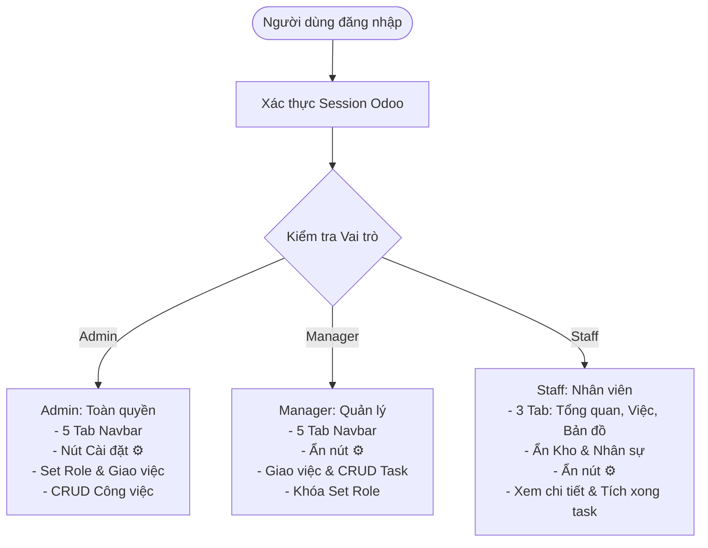

# Technical Plan: Quản Lý Nhân Sự & Phân Quyền Đa Tầng (Staff Management & RBAC)

**Feature Branch**: `010-staff-management-and-rbac`  
**Created**: 2026-10-10  
**Phase**: Bước 2 của Feature Development Lifecycle Policy  
**Spec Reference**: [`specs/010-staff-management-and-rbac/spec.md`](file:///home/tom/projects/FARM/Smart-Farm-main/new%20farm/Farm-Management-main/specs/010-staff-management-and-rbac/spec.md)

---

## 1. Tổng Quan Kiến Trúc (Architecture Overview)

Tính năng xây dựng hệ thống phân quyền 3 tầng (3-Tier RBAC) hoàn chỉnh tích hợp sâu vào kiến trúc Odoo 18 và giao diện Smart Farm Dashboard hiện có:
- **Tầng 1 (Database & Models)**: Mở rộng model `res.users` với trường `smart_farm_role` (`admin`, `manager`, `staff`). Đồng bộ quyền hệ thống Odoo với quyền Smart Farm.
- **Tầng 2 (Controllers & APIs Security)**: Bảo mật ở mức endpoint HTTP. Kiểm tra vai trò người dùng trong session khi thực hiện các hành vi CRUD công việc, truy cập tab dữ liệu và gán vai trò nhân sự.
- **Tầng 3 (QWeb Views & UI Rendering)**: Kiểm soát hiển thị động các tab trên Navbar (`Nhân sự`, `Kho & Sản phẩm`), nút Cài đặt ⚙️, thanh công cụ thêm việc, nút sửa/xóa task theo quyền hạn.
- **Tầng 4 (Frontend Interactions & Modals)**: Giao diện tab "Nhân sự" hiển thị danh sách nhân sự thực tế, popup gán quyền role (cho Admin), drawer xem chi tiết công việc (cho Nhân viên) và dropdown phân công nhiệm vụ.



---

## 2. Thiết Kế Mô Hình Dữ Liệu & Backend (Data Model Design)

### 2.1 Kế Thừa Model `res.users`
Tạo file model mới `smart_farm/models/res_users.py`:
```python
from odoo import models, fields, api

class ResUsers(models.Model):
    _inherit = 'res.users'

    smart_farm_role = fields.Selection([
        ('admin', 'Quản trị viên'),
        ('manager', 'Quản lý'),
        ('staff', 'Nhân viên'),
    ], string='Vai trò Smart Farm', default='staff', required=True)

    def get_smart_farm_effective_role(self):
        """Xác định vai trò thực tế: User thuộc base.group_system luôn là admin"""
        self.ensure_one()
        if self.has_group('base.group_system') or self.id == 2:
            return 'admin'
        return self.smart_farm_role or 'staff'
```

### 2.2 Nâng Cấp Model `smart.farm.task`
Cập nhật `smart_farm/models/task.py`:
- Đảm bảo trường `user_id` liên kết chính xác với nhân viên nông trại.
- Bổ sung logic phân quyền thao tác: Staff chỉ được cập nhật trạng thái `is_done`, chỉ Admin và Manager mới được tạo/sửa/xóa task.

---

## 3. Thiết Kế Endpoints & Quyền Truy Cập (API Endpoints & RBAC)

| Endpoint | Method | Quyền hạn yêu cầu | Mô tả chức năng |
| :--- | :---: | :---: | :--- |
| `/smart_farm/dashboard` | `GET` | Mọi user đăng nhập | Render dashboard; truyền biến `user_role`, `is_admin`, `is_manager`, `is_staff`, `staff_members` vào QWeb |
| `/smart_farm/api/user/set_role` | `POST` | **Chỉ Admin** | Cập nhật vai trò `smart_farm_role` cho một tài khoản người dùng |
| `/smart_farm/api/task/create` | `POST` | **Admin / Manager** | Tạo công việc mới và chỉ định nhân viên phụ trách (`user_id`) |
| `/smart_farm/api/task/update` | `POST` | **Admin / Manager** | Sửa thông tin công việc và thay đổi người phụ trách |
| `/smart_farm/api/task/delete` | `POST` | **Admin / Manager** | Xóa công việc |
| `/smart_farm/api/task/toggle` | `POST` | **Mọi role** (Admin, Manager, Staff) | Đánh dấu hoàn thành / chưa hoàn thành công việc |
| `/smart_farm/api/task/reorder`| `POST` | **Admin / Manager** | Sắp xếp lại thứ tự kéo thả công việc |

---

## 4. Thiết Kế Giao Diện Người Dùng (UI / UX Design)

### 4.1 Thanh Điều Hướng (Navbar)
1. **Nút Tab Navbar**:
   - `Tổng quan`: Render cho mọi role (`tab-overview`).
   - `Công việc`: Render cho mọi role (`tab-tasks`).
   - `Bản đồ`: Render cho mọi role (`tab-map`).
   - `Kho & Sản phẩm`: Render có điều kiện `t-if="user_role in ['admin', 'manager']"` (`tab-inventory`).
   - `Nhân sự`: Render có điều kiện `t-if="user_role in ['admin', 'manager']"` (`tab-staff`).
2. **Nút Thao Tác Góc Phải**:
   - `🌙 / ☀️ Chuyển Theme`: Hiển thị cho cả 3 roles.
   - `🔔 Chuông Thông Báo`: Hiển thị cho cả 3 roles.
   - `⚙️ Cài Đặt Hệ Thống`: Bọc trong điều kiện `t-if="user_role == 'admin'"`. Manager và Staff không nhìn thấy nút này.

### 4.2 Phân Hệ Quản Lý Nhân Sự (Tab `tab-staff`)
1. **Thống Kê Tổng Quan (Metric Cards)**:
   - Tổng số nhân sự nông trại
   - Số lượng Quản lý (Managers)
   - Số lượng Nhân viên (Staffs)
   - Tỷ lệ công việc hoàn thành của toàn đội
2. **Thanh Công Cụ Tìm Kiếm & Lọc**:
   - Tìm kiếm nhân sự theo tên, email, chức danh
   - Lọc phân loại: Tất cả / Quản lý / Nhân viên
3. **Danh Sách Nhân Sự Dạng Lưới Thẻ Hiện Đại (Staff Grid)**:
   - Thẻ hiển thị avatar ký tự hoặc ảnh đại diện
   - Tên, Email, Số điện thoại
   - Badge vai trò trực quan (Admin: vàng ánh kim, Manager: xanh ngọc/xanh biển, Staff: xanh lá)
   - Thông số nhiệm vụ: Số việc đang làm, số việc hoàn thành, thanh tiến độ %
   - **Nút "Giao việc"**: Mở modal tạo việc mới với trường Người phụ trách được điền sẵn nhân sự này (Khả dụng cho Admin & Manager).
   - **Thao tác "Đổi vai trò" (Set Role)**:
     - Với **Admin**: Hiển thị dropdown hoặc nút đổi role linh hoạt (Quản lý ⇄ Nhân viên).
     - Với **Manager**: Chỉ hiển thị huy hiệu vai trò tĩnh, không có nút/menu đổi role.
     - Bảo vệ tài khoản Superuser ID 2 không bị hạ role.

### 4.3 Phân Phối Quyền Hạn Trong Tab "Công Việc" (Tasks)
1. **Chế độ Nhân Viên (Staff View)**:
   - Ẩn nút `+ Thêm công việc` trên thanh tiêu đề.
   - Ẩn nút `Sửa` và nút `Xóa` trên từng thẻ công việc.
   - Ẩn tay cầm kéo thả `⋮⋮` (vô hiệu hóa kéo thả).
   - Khi click vào tiêu đề thẻ việc: Mở **Modal Chi Tiết Công Việc (Task Detail Modal)** hiển thị đầy đủ thông tin: Tiêu đề, phân loại, ngày thực hiện, người giao, ghi chú hướng dẫn kỹ thuật.
   - Nút tích `✓` hoàn thành: Cho phép nhân viên nhấn để chuyển trạng thái việc hoàn thành/chưa hoàn thành.
2. **Chế độ Quản Trị / Quản Lý (Admin & Manager View)**:
   - Hiển thị đầy đủ nút `+ Thêm công việc`, nút `Sửa`, nút `Xóa`, kéo thả sắp xếp.
   - Trong Form Modal Thêm/Sửa task: Bổ sung trường chọn **Người phụ trách** (`user_id`) cho phép chọn bất kỳ nhân viên nào trong danh sách nông trại.

---

## 5. Kế Hoạch Kiểm Thử & Nghiệm Thu (Verification Plan)

1. **Kiểm tra quyền Admin**:
   - Navbar có đủ 5 tab: `Tổng quan`, `Công việc`, `Bản đồ`, `Kho & Sản phẩm`, `Nhân sự`.
   - Có nút bánh răng Cài đặt ⚙️ ở góc phải.
   - Tab Nhân sự: Xem được danh sách, giao việc được, có dropdown đổi role giữa Manager và Staff.
   - Tab Công việc: Thêm, sửa, xóa, chọn người phụ trách, tích hoàn thành bình thường.
2. **Kiểm tra quyền Manager**:
   - Navbar có đủ 5 tab.
   - Nút bánh răng ⚙️ bị ẩn hoàn toàn (chỉ có 🌙 và 🔔).
   - Tab Nhân sự: Xem được danh sách, giao việc được, **KHÔNG** thể đổi role của nhân viên.
   - Tab Công việc: Thêm, sửa, xóa, giao việc bình thường.
3. **Kiểm tra quyền Staff**:
   - Navbar chỉ có 3 tab: `Tổng quan`, `Công việc`, `Bản đồ` (không thấy `Kho & Sản phẩm` và `Nhân sự`).
   - Nút bánh răng ⚙️ bị ẩn hoàn toàn.
   - Tab Công việc: Không có nút thêm việc, không có nút sửa/xóa; click vào việc mở drawer chi tiết; tích hoàn thành hoạt động trơn tru.
